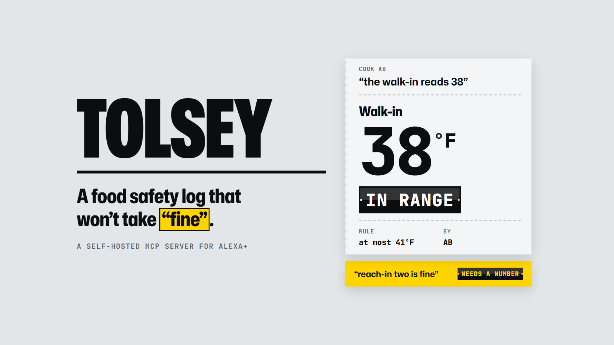
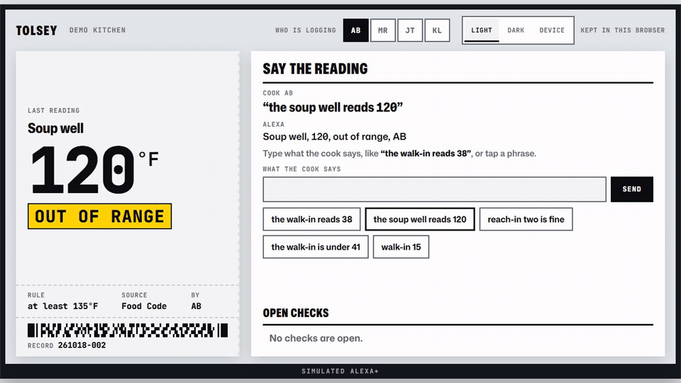
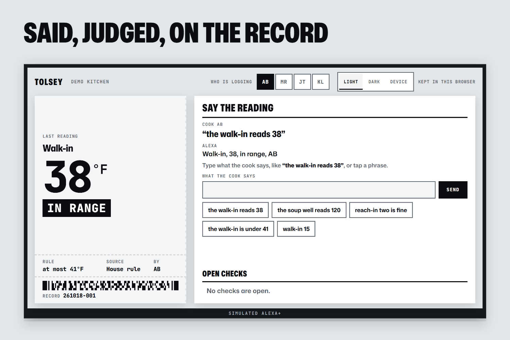
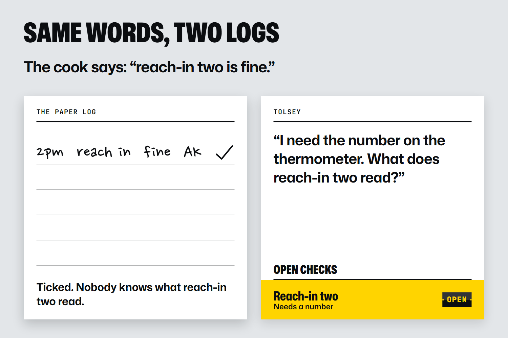
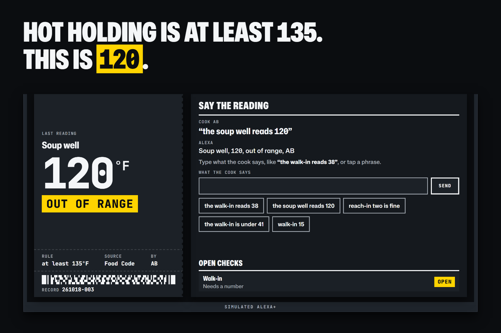

# Tolsey



A food safety log for small restaurant kitchens that you fill in by voice. Say the reading, and it
lands in the day's record, judged against the rule that applies. A reading outside its rule is
marked out of range. A check with no number is refused and stays open until a number is logged
for it. One recorded run against the deployed server, with every request and answer:
[`examples/deployed-run.json`](examples/deployed-run.json).



"Reach-in two is fine" is refused and the check stays open, until the cook gives the number: 38, in range.

## See it run

Try it with no install at [tolsey.taranity.com](https://tolsey.taranity.com), a simulated Alexa+
screen that is a real MCP client of the deployed server. Tap a phrase or type what a cook would say,
with the number in digits. The demo video, 2:45:
[youtu.be/zx2u-TCy7jI](https://youtu.be/zx2u-TCy7jI).



A reading, judged as it is taken: the walk-in at 38 is in range, with its rule and a record code.



The same words in two logs: the paper log ticks the line, Tolsey asks for the number.



A reading outside its rule: hot holding is at least 135°F, so the soup well at 120 is out of range,
with the Food Code named as the source.

What Tolsey will not log as said:

- A check with no number, like "reach-in two is fine". It asks what the thermometer reads.
- A limit or a guess, like "the walk-in is under 41". It asks for the reading.
- A number that could be heard two ways, when that would change the verdict. "Walk-in 15" gets
  "Say it one digit at a time", because fifteen and fifty sound alike across a loud kitchen.

## Why

Holding food at the wrong temperature is one of the two problems FDA finds most often in US
restaurants
([FDA, 2023](https://www.fda.gov/food/hfp-constituent-updates/fda-releases-2017-2018-report-occurrence-foodborne-illness-risk-factors-fast-food-and-full-service)).
In FDA's 2017 to 2018 data collection in 851 restaurants, cold holding headed the practices that
most need improvement, and full-service restaurants with a working food safety system (procedures,
training and monitoring) averaged 2.2 items out of compliance against 5.3 for those with none
([FDA poster](https://www.fda.gov/media/169149/download)). In a small kitchen the monitoring is
usually a paper log on the walk-in door, and a paper log accepts a line nobody measured. Tolsey
takes the reading by voice, judges it as it is taken, and refuses a check without a number.

## How it works

Tolsey is an MCP server (spec 2025-11-25, Streamable HTTP) built for Alexa+, running on Cloudflare
Workers with D1. It registers two tools: `log_reading` writes a judged line to the day's record,
and `due_now` says which checks are still open. The rules are the FDA Food Code 2022 defaults plus
house rules named as such, in [data/rules/food-code-2022.json](data/rules/food-code-2022.json).
Details in [docs/API.md](docs/API.md) and [docs/ARCHITECTURE.md](docs/ARCHITECTURE.md).

Not built yet: corrective actions with a clock, MCP Apps cards, the printable day sheet and a
replay. The Alexa+ screen is simulated, because the Alexa+ MCP toolkit is not open to this event's
entrants.

## Setup

Requirements: Node.js 24.11 or newer with npm 11.18 or newer (Node 24.20 and later bundle it).

```sh
npm ci --ignore-scripts
npm rebuild esbuild workerd
cp .env.example .dev.vars
npm run dev
```

The install runs with scripts off, then builds only the two packages that need their install step,
so no other dependency's install script runs, whatever the npm version. With npm 11.18 or newer a
plain `npm install` is held to the same two by `allowScripts` in `package.json`. An older npm only
warns about its version there and runs every install script.

## Checks

```sh
npm run gate          # types, lint, duplication, dependency rules, env parity
npm run verify:ship   # the full check before anything ships
```

## License

MIT, see [LICENSE](LICENSE).
