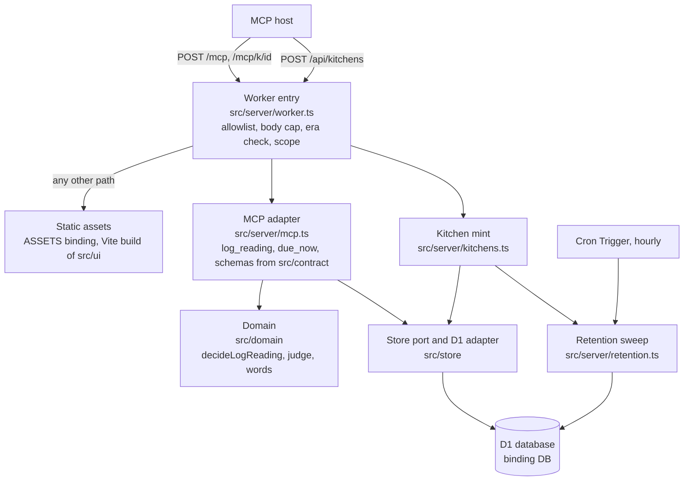

# Architecture

This document describes the code as it stands: two MCP tools, `log_reading`, which writes the
record, and `due_now`, which reads it, their storage, and the routes around them. The decisions behind the stack and the storage are recorded in
[ADR 0001: Stack](adr/0001-stack.md) and [ADR 0002: Storage](adr/0002-storage.md), and this page
links to them rather than repeating them.

## System overview

Tolsey is a single Cloudflare Worker (`src/server/worker.ts`, the `main` entry in `wrangler.jsonc`)
that serves an MCP endpoint over Streamable HTTP at protocol version 2025-11-25, a small JSON API
that creates scratch kitchens, and a set of static client pages through the Workers asset binding.
Its input is a spoken temperature reading sent by an MCP host as a `log_reading` tool call; its
output is a tool result (a short sentence for the voice reply plus `structuredContent`) and one
line appended to a food safety record held in Cloudflare D1. An hourly Cron Trigger deletes scratch
kitchens past their retention age. The code is layered as ports and adapters: a pure domain layer
decides what a call means and what to store, a server adapter supplies the clock, the request scope
and the store, and a store port has a D1 adapter for the Worker and an in-memory adapter for tests.
The MCP handler is stateless: a fresh server is built for every request and all state lives in D1.

What exists today: `log_reading` and `due_now` are the registered tools. The wall page
(`src/ui/WallView.tsx`, driven by `src/ui/wall-session.ts` through the MCP client in
`src/client/mcp-client.ts`) mints a scratch kitchen and calls `log_reading` with the words typed or
tapped, then shows the reply and the logged line exactly as the result gives them. The other four
tool names and descriptions are fixed in `src/contract/tools.ts`, which notes that they arrive
later. The card
resources (`ui://tolsey/reading.html` and three others) are fixed as constants in the same file;
ADR 0002 records that they are attached to tool definitions in phase 2.

## Component diagram



Rule rows, the demo kitchen profile and the store limits are JSON files under `data/`, loaded and
validated once in `src/server/data.ts` and handed to the MCP adapter and the domain as arguments.

## Data flow

### A `log_reading` call

1. **Routing.** `wrangler.jsonc` sends `/mcp`, `/mcp/*` and `/api/*` to the Worker first
   (`run_worker_first`); every other path goes to the asset binding with single-page-application
   fallback. `familyOf` in `worker.ts` mirrors that list. `/privacy` is served from `privacy.html`
   before that fallback runs. The static pages carry the Content-Security-Policy, nosniff and
   no-referrer headers from `public/_headers`, while Worker answers on `/mcp` and `/api` keep the
   headers the Worker sets, since the asset binding applies `_headers` only to the responses it builds.
2. **Front checks.** `parseAllowlist` (`src/server/allowlist.ts`) reads `ALLOWED_HOSTNAMES`; a
   missing or malformed list answers 503 `allowlist_unconfigured`. The SDK's
   `hostHeaderValidationResponse` and `originValidationResponse` then check the request against the
   list, because `createMcpHandler` performs no Host or Origin validation of its own.
3. **Body.** `readCappedBody` (`src/server/guards.ts`) reads the stream once and cancels it past
   64 KiB (413). `refuseModernEra` answers anything that is not a 2025-era request with a JSON-RPC
   error, so an auto-negotiating client falls back to 2025-11-25.
4. **Scope.** `resolveScope` (`src/server/scope.ts`) maps the path to a kitchen: `/mcp` is the
   seeded, read-only demo kitchen, `/mcp/k/<32 hex characters>` is a scratch kitchen looked up with
   `Store.findKitchen`, and anything else is a JSON-RPC 404. The path is the only input that chooses
   where a write lands; no tool argument does.
5. **Handler.** `createMcpHandler(() => createServer(deps))` builds a server for this request, with
   the store, clock, kitchen, rule table, profile and limits closed over in `ServerDeps`.
6. **Decision.** In `logReading` (`src/server/mcp.ts`): a demo kitchen answers `demo_read_only`;
   the clock is read once; the arguments, less `request_id`, are hashed with SHA-256; a stored event
   with the same `request_id` answers the call through `classifyRepeat` before anything is decided.
   Otherwise the adapter reads the context the domain needs (`latestByScreen` when the words say a
   correction such as "wrong number", or `pendingPrompt` for a `pending_prompt_id`) and calls
   `decideLogReading`, which is pure. A rejection (`initials_not_on_roster`) stores nothing.
7. **Append.** The decided event goes to `Store.append` with a row reservation from
   `expectedRowsFor`. In `D1Store` one guarded INSERT checks the write window, the per-kitchen line
   cap and the daily row budget, allocates the day line, and writes the record code into the stored
   result with `json_set`. If another request answered the same prompt or superseded the same line
   first (a unique-index conflict), `secondAnswerFor` decides the call once more from what is now
   stored.
8. **Reply.** The stored `result_json` is returned as the tool result. Refusals become error results
   with a spoken sentence and a machine code in `_meta.error` (`kitchen_closed`, `kitchen_full`,
   `demo_full`, `request_id_reused`, `request_id_expired`). Any thrown fault is logged by `logFault`
   with the error's name and code only, never its message, and answered with a fixed sentence under
   `server_fault`.

### A `due_now` call

Steps 1 to 5 are the same as for `log_reading`. In `dueNow` (`src/server/mcp.ts`) the clock is read
once, `businessDay` turns it into the kitchen's day, and `Store.openChecks` returns the ids of the
check points whose newest line that day is a refusal, a held reading or a `wrong_number` marker. The
adapter keeps the profile's order of check points, adds their names, and answers a sentence plus
`structuredContent`. Nothing is appended, so the demo kitchen answers it as well; a thrown fault is
answered under `server_fault` as above.

### Minting a scratch kitchen

`POST /api/kitchens` is handled by `handleKitchensRoute` (`src/server/kitchens.ts`). It accepts only
POST (405 otherwise), only a JSON content type when a body is sent (415), and only an optional
`label` from the closed list `capture` or `conformance` (400 for anything else). `mintKitchen`
reads the day's row budget first and refuses at once when it is spent (503 `demo_full`), runs one
bounded retention round, then inserts the kitchen under the same budget guard. A created kitchen is
answered 201 with `id`, `mcpPath` (`/mcp/k/<id>`), `closesAt` (end of the write window) and
`expiresAt` (when it is due to be deleted, while the hourly runs succeed and start on time).

### Retention

The Worker's `scheduled` handler runs `runScheduledSweep` (`src/server/retention.ts`) on the hourly
schedule `0 * * * *`. The trigger's `scheduledTime` decides which kitchens have expired, and the
Worker's clock dates each round's budget charge, so a run that starts late still counts its deletes on
the UTC day they were written. Each round selects expired
scratch kitchens through the `kitchens_expiry` index and deletes the kitchens, their events and their
line counters in one batch of three statements; these are the only DELETE statements in the
codebase. The limits (`retentionAgeHours`, `sweepBatchLimit`, `cronSweepBatchLimit`,
`maxSweepRounds`) come from `data/store/limits.json`. The bounds this gives, and why writes close one
retry window before retention age, are set out in ADR 0002 under "Write model".

## Key abstractions

| Abstraction | File | Role |
|-------------|------|------|
| `createWorker`, `WorkerEnv` | `src/server/worker.ts` | Worker entry: `fetch` routing and front checks, `scheduled` sweep; takes a `Clock` and an optional store factory so tests can inject both |
| `createServer`, `ServerDeps`, `Clock` | `src/server/mcp.ts` | Builds the per-request `McpServer` and registers `log_reading` and `due_now`; reads the clock once per tool call and passes it down |
| `LogReadingInputSchema`, `LogReadingOutputSchema` | `src/contract/log-reading.ts` | Zod schemas for the tool's input and `structuredContent`, including which fields each outcome must and must not carry |
| `DueNowInputSchema`, `DueNowOutputSchema` | `src/contract/due-now.ts` | Zod schemas for `due_now`: an empty input object, and the open checks of the day with its business day and time zone |
| `TOOL_NAMES`, `TOOL_DESCRIPTIONS`, `UI_RESOURCE_URIS` | `src/contract/tools.ts` | The full tool set and card resource URIs, fixed ahead of registration |
| `decideLogReading`, `Decision`, `DecisionContext` | `src/domain/log-reading.ts`, `src/domain/decision.ts` | Pure decision from the call and the context the adapter read: roster check, correction, prompt answer or fresh reading |
| `judgeReading` | `src/domain/judge.ts` | Compares a reading in tenths of a degree with the limit it is handed, inclusive both ways |
| `businessDay`, `recordCode` | `src/domain/business-day.ts` | The kitchen's business day from an instant, its time zone and day start, and the `YYMMDD-NNN` record code |
| `needsDigitRepeat` | `src/domain/twins.ts` | Asks the cook to repeat a number when its commonly misheard twin (fifteen and fifty) would flip the verdict, or when it falls outside the check point's coarse band |
| `Store`, `D1Like` | `src/store/port.ts` | The storage port: no method edits or removes an event; `D1Like` is the structural subset of D1 the adapters use |
| `D1Store` | `src/store/d1-store.ts` | D1 adapter; invariants are held by guarded SQL and unique indexes, never by a read before a write |
| `MemoryStore` | `src/store/memory-store.ts` | In-memory `Store` for tests and harnesses; the Worker never imports it |
| `expectedRowsFor`, `classifyRepeat` | `src/store/port.ts` | The row reservation for an append, and the one rule for a repeated `request_id` (duplicate, expired or reused) |
| `mintKitchen` | `src/server/kitchens.ts` | The one place a scratch kitchen id (128 random bits, hex) is made |
| `runScheduledSweep`, `expireKitchens` | `src/server/retention.ts` | Bounded retention rounds |

## Storage

D1, bound as `DB`, holds four tables, created by the migrations in `migrations/`:

| Migration | Adds |
|-----------|------|
| `0001_record.sql` | `kitchens` (with the seeded `demo` row), the append-only `events` table, its unique and partial unique indexes, and `budget` (rows written per UTC date) |
| `0002_append_only_guard.sql` | Triggers that abort any UPDATE of an event, any DELETE of an event whose kitchen still exists, and any UPDATE of a kitchen |
| `0003_kitchen_lines.sql` | `kitchen_lines`, a per-kitchen line counter read by key for the line cap |
| `0004_bounded_reads.sql` | The `events_screen`, `events_ref` and `events_root` indexes that keep each read a handful of rows |

Every line, whether a reading, refusal, held question, `wrong_number` marker or receipt, is one row
of `events`. A correction is a new line that points at the one it supersedes. The meaning of each
column, the idempotency key, the measured rows per write (`data/store/rows-per-write.json`) and the
read bounds are documented in ADR 0002.

## Layer boundaries

`.dependency-cruiser.cjs` (run by `npm run gate:deps`) turns these boundaries into errors:

- `no-ui-to-server`: nothing under `src/ui` imports `src/server`.
- `domain-is-pure`: `src/domain` never imports `src/store` or `src/server` at run time. Type-only
  imports, such as the `PendingPrompt` and `NewEvent` shapes from `src/store/port.ts`, are erased
  before the check.
- `domain-reads-no-data`: the domain never imports `data/`; rule rows and the profile arrive as
  arguments from `src/server/data.ts`.
- `judge-never-reads-rules`: `src/domain/judge.ts` sees only the limit it is handed.
- `no-circular`: no circular dependencies anywhere.

## Test targets

`vitest.config.ts` defines five projects. `unit` covers `src/domain`, `src/contract`, `src/client`
and `src/ui` (the page's render tests use `react-dom/server`, with no browser); `store` runs
the store suite against a local D1 from wrangler's `getPlatformProxy`; `conformance` runs the
server tests in process; `e2e` runs the built Worker in workerd; and `deployed` runs the
conformance file against a deployed Worker. `src/test-support/target.ts` resolves which of these
targets a conformance run drives.

## Directory structure

```text
src/
  server/        Worker entry, routing and front checks, the MCP adapter, kitchen mint, retention
  domain/        Pure decisions: words, prompts, corrections, judging, business days, rule schemas
  contract/      Tool names, descriptions, annotations, card URIs and the log_reading and due_now schemas
  store/         The Store port, the D1 adapter and the in-memory adapter
  client/        Fetch-based MCP client shared by the wall and the capture
  ui/            The wall page (React components, the session, the intent layer) and the privacy page's
                 theme switch and styles
  test-support/  Shared test harnesses, fixtures and counting or gated store wrappers
index.html       The wall's HTML shell, holding the pre-paint theme script the CSP allows by its hash
privacy.html     The privacy notice, a second static page in the Vite build, with the same script
public/
  fonts/         Self-hosted Mona Sans and JetBrains Mono with their licence
  _headers       The Content-Security-Policy, nosniff and no-referrer headers for every static page
data/
  kitchens/      The demo kitchen profile: roster, foods, check points, schedule, vocabulary
  rules/         The rule table (FDA Food Code 2022 rows, with sources)
  store/         Store limits and measured rows per write
migrations/      D1 schema, applied in order by wrangler
scripts/         Repository gates and the deploy preflight
design/          Art direction and static HTML mockups, not part of the build
docs/            These guides, architecture decision records and compliance records
```

- `src/server` is the only layer that touches the platform: requests, bindings, the clock and the
  Cron Trigger.
- `src/domain` holds every decision about what a call means, so the same decision runs in any
  test or host. It reads no storage, no clock and no data files.
- `src/contract` is shared by the adapter and the domain, so the schema the host sees and the shape
  the domain produces are one definition.
- `src/store` keeps storage behind one port, with two adapters held to the same contract tests
  (`src/store/store.contract.test.ts`).
- `data/` keeps the rule table, the kitchen profile and the limits out of code, so changing a limit is
  a data change validated at load (`src/server/data.ts` fails at load when a check point names a
  missing rule).
- `migrations/` feeds both the tests and the deployed database. `npm run deploy` runs the build,
  `scripts/deploy-preflight.mjs`, `wrangler d1 migrations apply DB --remote`,
  `scripts/check-remote-migrations.mjs` and `wrangler deploy`, in that order.
